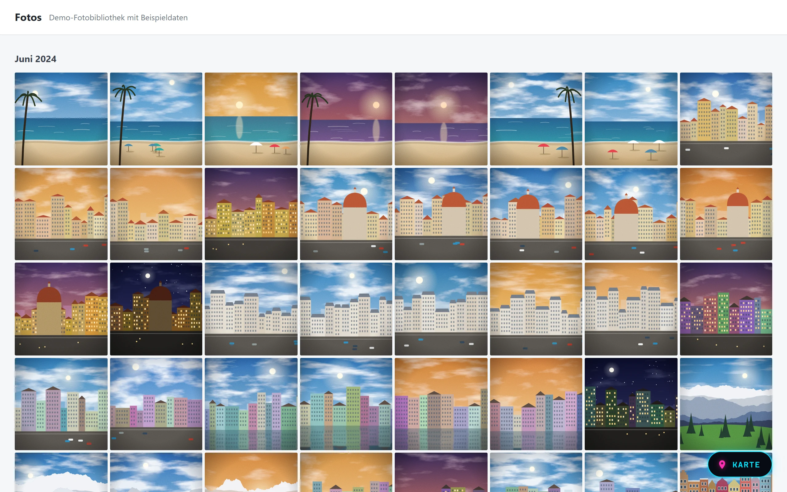
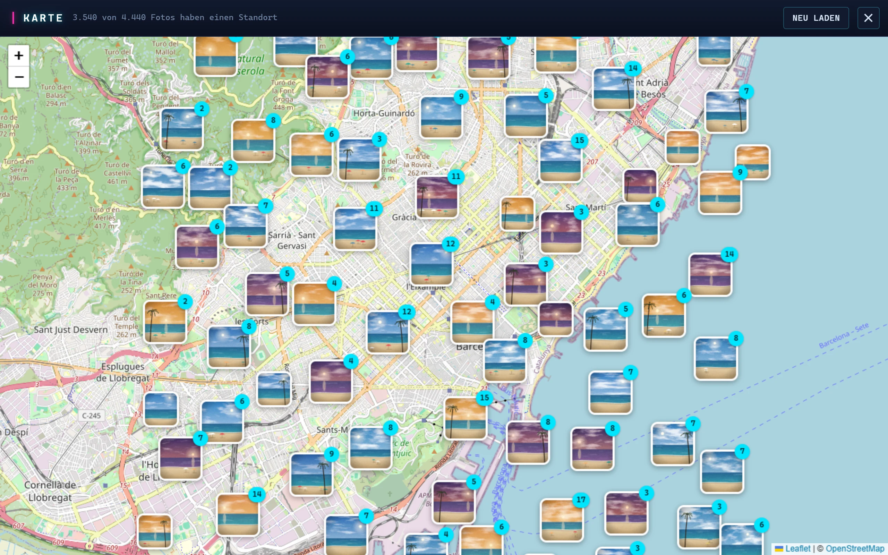
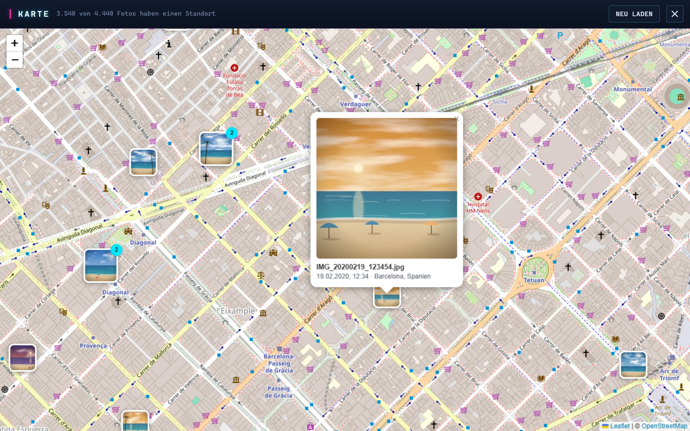
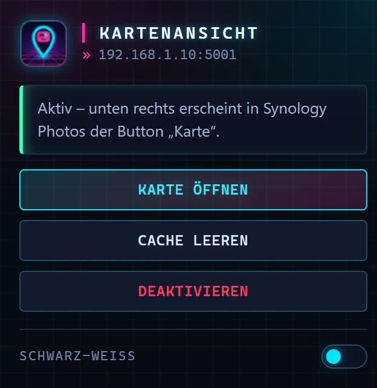

# Synology Photos – Kartenansicht (Browser-Erweiterung)

Ergänzt die Weboberfläche von Synology Photos um eine Karte mit allen Fotos, die GPS-Daten haben –
wie in der Android-/iPhone-App. Funktioniert in Chrome und Edge (ab Version 111).

**Projektseite mit Screenshots, Funktionsweise und Stack:** [docs/index.html](docs/index.html)
(über GitHub Pages: https://mafi-code.github.io/maps-extension-for-synology-photos/)

## Screenshots

Alle Screenshots zeigen Demo-Daten (gezeichnete Beispielmotive an echten Reisezielen), keine echten Fotos.

| | |
|---|---|
|  |  |
| **Ein Button:** unten rechts erscheint „Karte“. | **Bis auf Straßenebene:** Gruppen teilen sich beim Zoomen auf. |

**Klick auf ein Foto** zeigt eine große Vorschau mit Dateiname, Aufnahmezeit und Ort.

**Das Popup:** pro NAS-Adresse aktivieren, Karte öffnen, Cache leeren.

## Installation

1. `chrome://extensions` (bzw. `edge://extensions`) öffnen.
2. **Entwicklermodus** einschalten.
3. **Entpackte Erweiterung laden** → diesen Ordner `synology-photos-map` auswählen.
4. Synology Photos im Browser öffnen und anmelden.
5. Auf das Erweiterungs-Symbol klicken → **Für diese Adresse aktivieren** → Zugriff erlauben.
   Die Seite lädt neu, unten rechts erscheint der Button **Karte**.

Die Erweiterung bekommt nur Zugriff auf die eine NAS-Adresse, für die sie aktiviert wurde.
Über das Symbol lässt sie sich jederzeit wieder deaktivieren.

## So funktioniert es

- Nutzt die bestehende Anmeldung im Browser – kein zweites Passwort, gleiche Rechte wie in Synology Photos.
- Lädt persönlichen und (falls vorhanden) geteilten Bereich über die Synology-Photos-Web-API.
- Karte: OpenStreetMap, Fotos werden zu Gruppen zusammengefasst; Klick auf ein Foto zeigt eine größere Vorschau.
- Die Kartenkacheln lädt das Skript auf der Synology-Seite (OpenStreetMap verlangt einen Referer,
  den die Erweiterungsseite selbst nicht sendet). Dabei geht nur die NAS-Adresse als Referer an OpenStreetMap,
  sonst werden keine Daten an Dritte geschickt.

## Cache (30 Tage)

- **Standorte** werden pro NAS-Adresse **und pro Benutzer** 30 Tage gespeichert. Innerhalb dieser Zeit
  erscheint die Karte sofort mit dem gespeicherten Stand; **„Neu laden“** holt aktuelle Daten und
  startet die 30 Tage neu. Neue oder gelöschte Fotos sind erst nach „Neu laden“ sichtbar.
- **Vorschaubilder** (klein/mittel) werden ebenfalls 30 Tage gespeichert. Bearbeitete Fotos bekommen
  automatisch ein neues Vorschaubild.
- Gespeichert wird in der Datenbank der Erweiterung im Browserprofil – die Synology-Seite kann sie nicht lesen.
- Unvollständige Ladevorgänge werden nie gespeichert.
- **„Cache leeren“** im Popup löscht alles sofort; abgelaufene Einträge werden automatisch entfernt.

## Wenn keine Fotos erscheinen

Die Synology-Photos-API ist nicht offiziell dokumentiert. Findet die Erweiterung keine GPS-Daten,
zeigt sie einen gelben **Diagnose**-Kasten. Diesen Text kopieren und weitergeben – daran lässt sich
erkennen, in welchem Feld die NAS die Koordinaten liefert. Zusätzliche Infos stehen in der
Browser-Konsole (F12) unter `[Kartenansicht]`.

## Entwicklung

Kein Build-Schritt und keine npm-Abhängigkeiten. Für die Werkzeuge in `tools/` werden Node.js ab 22
und Microsoft Edge gebraucht (Google Chrome lädt seit Version 137 keine Erweiterungen per Kommandozeile mehr).

| Befehl | Zweck |
|---|---|
| `npm test` | End-to-End-Test gegen eine simulierte Synology Photos (erstes Laden, Cache, 70.000 Fotos mit NAS-Aussetzer) |
| `npm run screenshots` | erzeugt `docs/screenshots/*.webp` mit Demo-Daten neu |
| `npm run logo` | rendert `assets/*.svg` zu den Icons in `icons/` sowie `docs/logo.png` und `docs/banner.png` |

## Dateien

| Datei | Zweck |
|---|---|
| `manifest.json` | Erweiterungs-Definition |
| `popup.html/js` | Aktivieren/Deaktivieren pro NAS-Adresse |
| `page-hook.js` | liest Session-Token und API-Pfad der Synology-Photos-App mit |
| `content.js/css` | Button, Overlay, Laden der Fotos und Vorschaubilder |
| `map.html/js/css` | Karte (Leaflet) im Erweiterungs-iframe |
| `vendor/` | Leaflet 1.9.4, Leaflet.markercluster 1.5.3 |
| `icons/` | Erweiterungs-Icons (aus `assets/` gerendert) |
| `assets/` | Logo, kleines Icon und Banner als SVG-Quellen |
| `tools/` | Test, Screenshots und Logo-Rendering (nicht Teil der Erweiterung) |
| `docs/` | Projektseite für GitHub Pages |
