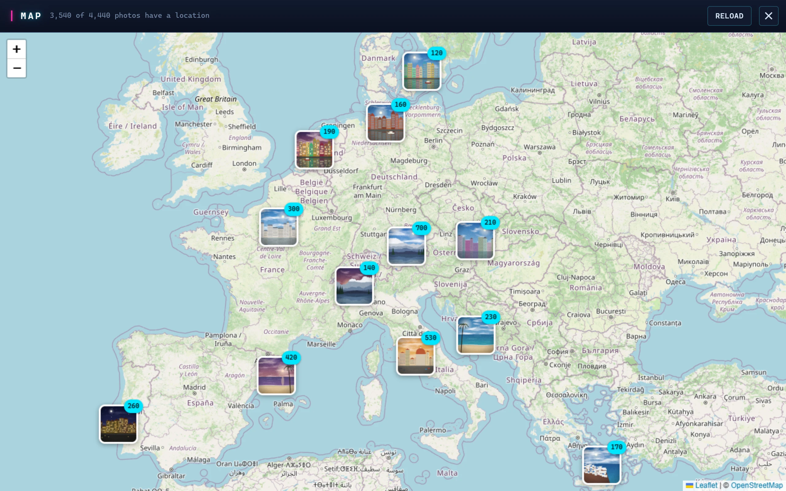
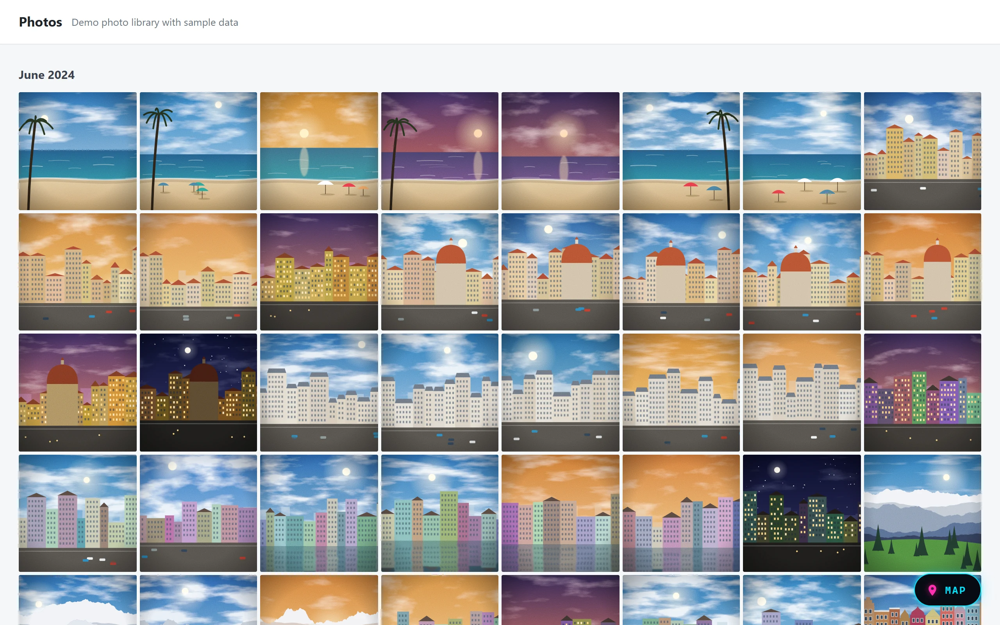
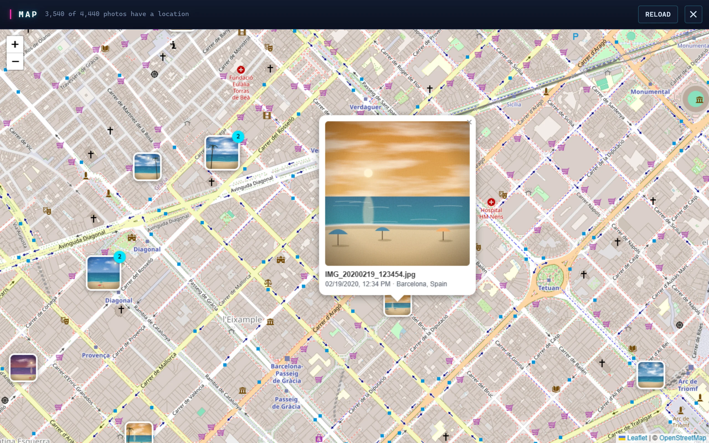
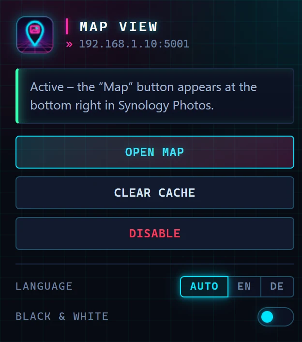

**English** · [Deutsch](README.de.md)

# Map View for Synology Photos (browser extension)

Adds a map with all geotagged photos to the Synology Photos web interface – like the map in the
Android/iPhone app. Works in Chrome and Edge (version 111 or later).
The interface is in English or German – automatically from the browser language, or chosen in the popup.

**Project page with screenshots, architecture and stack:** [docs/index.html](docs/index.html)
(via GitHub Pages: https://mafi-code.github.io/maps-extension-for-synology-photos/)

## Screenshots

All screenshots use demo data (generated sample scenes at real travel destinations), no real photos.

| | |
|---|---|
|  |  |
| **One button:** “Map” appears at the bottom right. | **Down to street level:** clusters split up as you zoom in. |

**Click a photo** for a large preview with file name, capture time and place.

**The popup:** enable per NAS address, open the map, clear the cache, language (Auto / EN / DE), black & white mode.

## Installation

1. Open `chrome://extensions` (or `edge://extensions`).
2. Turn on **Developer mode**.
3. **Load unpacked** → select the folder of this repository.
4. Open Synology Photos in the browser and sign in.
5. Click the extension icon → **Enable for this address** → allow access.
   The page reloads and the **Map** button appears at the bottom right.

The extension only gets access to the one NAS address you enable it for.
You can disable it again at any time via the icon.

## How it works

- Uses your existing browser session – no second password, same permissions as in Synology Photos.
- Loads the personal space and (if available) the shared space through the Synology Photos web API.
- Map: OpenStreetMap; photos are grouped into clusters, clicking a photo shows a larger preview.
- Map tiles are loaded by the script on the Synology page (OpenStreetMap requires a Referer, which the
  extension page itself doesn’t send). Only the NAS address is sent to OpenStreetMap as Referer;
  no other data goes to third parties.

## Cache (30 days)

- **Locations** are stored for 30 days per NAS address **and per user**. Within that time the map
  appears instantly with the stored state; **“Reload”** fetches current data and restarts the 30 days.
  New or deleted photos only show up after “Reload”.
- **Thumbnails** (small/medium) are stored for 30 days as well. Edited photos automatically get a new thumbnail.
- Everything is stored in the extension’s database in the browser profile – the Synology page can’t read it.
- Incomplete loads are never stored.
- **“Clear cache”** in the popup deletes everything immediately; expired entries are removed automatically.

## If no photos appear

The Synology Photos API isn’t officially documented. If the extension finds no GPS data, it shows a
**Diagnostics** box. Copy that text and pass it on – it shows in which field the NAS delivers the
coordinates. More details are in the browser console (F12), prefixed with `[Kartenansicht]`.

## Development

No build step and no npm dependencies. The tools in `tools/` need Node.js 22+ and Microsoft Edge
(Google Chrome no longer loads extensions from the command line since version 137).

| Command | Purpose |
|---|---|
| `npm test` | End-to-end test against a simulated Synology Photos (first load, cache, 70,000 photos with a NAS hiccup, English UI) |
| `npm run screenshots` | regenerates `docs/screenshots/{en,de}/*.webp` with demo data |
| `npm run logo` | renders `assets/*.svg` to the icons in `icons/`, `docs/logo.png` and the banners |

UI texts live in `_locales/en/messages.json` and `_locales/de/messages.json`.

## Files

| File | Purpose |
|---|---|
| `manifest.json` | Extension definition |
| `_locales/` | UI texts (English, German) |
| `popup.html/js` | Enable/disable per NAS address, black & white mode |
| `page-hook.js` | Picks up the session token and API path used by the Synology Photos app |
| `content.js/css` | Button, overlay, loading photos, thumbnails and map tiles |
| `map.html/js/css` | Map (Leaflet) in the extension iframe, cache |
| `vendor/` | Leaflet 1.9.4, Leaflet.markercluster 1.5.3 |
| `icons/` | Extension icons (rendered from `assets/`) |
| `assets/` | Logo, small icon and banners as SVG sources |
| `tools/` | Test, screenshots and logo rendering (not part of the extension) |
| `docs/` | Project page for GitHub Pages (`index.html` English, `de.html` German) |

## License

[MIT](LICENSE) © mafi-code. The bundled libraries in `vendor/` keep their own licenses:
Leaflet (BSD 2-Clause, [vendor/LICENSE-leaflet.txt](vendor/LICENSE-leaflet.txt)) and
Leaflet.markercluster (MIT, [vendor/LICENSE-markercluster.txt](vendor/LICENSE-markercluster.txt)).

Unofficial project, not affiliated with Synology Inc. “Synology” and “Synology Photos” are trademarks of Synology Inc.
